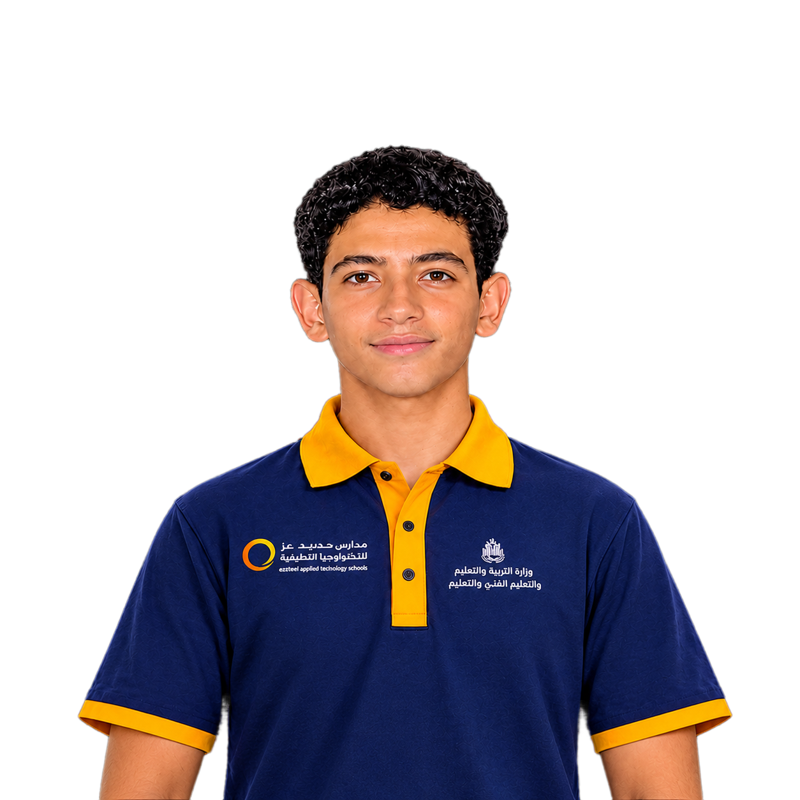

# MARO Smart Sign Glove
### A Voice for Every Sign

<p align="center">
  
</p>

<p align="center">
  **نحو تواصل أسهل باستخدام التكنولوجيا والأنظمة المدمجة**
</p>

<p align="center">
  <a href="https://alostoura-official.github.io/MARO-Smart-Sign-Glove/">معاينة المشروع</a> •
  <a href="https://github.com/Alostoura-Official/MARO-Smart-Sign-Glove">GitHub Repository</a>
</p>

---

## 📌 نبذة عن المشروع

**MARO Smart Sign Glove** هو مشروع بحثي ونموذج أولي لقفاز ذكي يهدف إلى المساعدة في تحويل بعض حركات وإشارات اليد إلى نصوص وأصوات مسموعة باستخدام تقنيات الأنظمة المدمجة والاستشعار الإلكتروني والبرمجيات.

يعتمد المشروع على مجموعة من الحساسات المثبتة بالقفاز لقراءة انحناء الأصابع وحركة اليد واتجاهها، ثم معالجة القراءات بواسطة وحدة تحكم إلكترونية لإنتاج نتائج يمكن عرضها أو تحويلها إلى صوت.

يركز المشروع على دعم التواصل مع الأشخاص الصم وغير الناطقين، مع استهداف تطوير نموذج قابل للتوسع لدعم لغة الإشارة المصرية.

> **ملاحظة:** المشروع نموذج أولي قيد التطوير والاختبار، ولا يمثل حاليا مترجما شاملا أو معتمدا للغة الإشارة المصرية. دقة التعرف تعتمد على الإشارات التي يتم تنفيذها وتدريب النظام واختبارها.

## 🎯 أهداف المشروع

- المساهمة في تقليل صعوبات التواصل اليومي
- تطوير قفاز إلكتروني قادر على استشعار حركات الأصابع واليد
- تحويل الإشارات المدعومة إلى نصوص قابلة للعرض
- إتاحة إخراج صوتي للعبارات المدعومة
- دراسة إمكانية توظيف الذكاء الاصطناعي في تحسين التعرف على الإشارات
- إنشاء منصة برمجية قابلة للتطوير والعمل دون اتصال بالإنترنت

## ⚙️ المكونات والتقنيات

### المكونات الإلكترونية

| المكون | الوظيفة |
|---|---|
| ESP32 | وحدة التحكم الرئيسية |
| Flex Sensors | قياس انحناء الأصابع |
| MPU6050 | قياس التسارع والدوران واتجاه الحركة |
| OLED SSD1306 | عرض البيانات والنتائج |
| DFPlayer Mini | تشغيل الملفات الصوتية |
| Battery 3.7V | مصدر الطاقة |
| Voltage Dividers | تهيئة إشارات حساسات الانحناء |

قد تختلف المكونات النهائية حسب إصدار النموذج الأولي والتجارب الهندسية.

### التقنيات البرمجية

- Arduino IDE لتطوير البرنامج الثابت
- C/C++ لبرمجة ESP32
- HTML5 لبناء واجهة الموقع
- CSS3 لتنسيق وتصميم الواجهة
- JavaScript للتفاعل ومعالجة البيانات
- Service Worker لدعم التخزين المؤقت والعمل دون اتصال
- Web App Manifest لتثبيت التطبيق
- MediaPipe لدراسة التعرف البصري على حركات اليد عند توفر متطلبات تشغيله

## 🧠 آلية العمل

1. يضع المستخدم القفاز في يده.
2. تقيس حساسات Flex مقدار انحناء الأصابع.
3. يقرأ MPU6050 بيانات حركة اليد واتجاهها.
4. يستقبل ESP32 القراءات من الحساسات.
5. تتم معالجة القراءات ومقارنتها بالإشارات التي يدعمها البرنامج.
6. تظهر النتيجة في صورة نص على واجهة النظام.
7. يمكن إخراج الصوت للإشارات المدعومة عند تفعيل وحدة الصوت وتجهيز الملفات المناسبة.

**مسار العمل المبسط:**

```text
Hand Movement
      |
      v
Flex Sensors + MPU6050
      |
      v
     ESP32
      |
      v
Signal Processing
      |
      v
Supported Sign Recognition
      |
      v
  Text Output
      |
      v
  Voice Output
```

## 🌐 منصة المشروع

يحتوي المشروع على واجهة ويب تشرح فكرة القفاز ومكوناته وطريقة عمله، وتوفر مواد توثيقية ورسومات هندسية ومصادر برمجية مرتبطة بالتطوير.

### المميزات

- واجهة عربية تدعم اتجاه الكتابة من اليمين إلى اليسار
- تصميم متوافق مع أحجام الشاشات المختلفة
- عرض صور النموذج الأولي والتوصيلات
- عرض مخططات التوصيل وآلية العمل
- توثيق المكونات والبرمجيات
- اختبار الاتصال التسلسلي USB عند استخدام متصفح متوافق وجهاز يدعم Web Serial
- تجربة تفاعلية لبعض وظائف الواجهة
- دعم تثبيت الموقع كتطبيق PWA
- تخزين ملفات الموقع الأساسية للاستخدام دون إنترنت
- صفحة احتياطية عند انقطاع الاتصال

## 📱 تطبيق PWA والعمل دون إنترنت

تم تجهيز الموقع ليعمل كتطبيق ويب تقدمي Progressive Web App.

يعتمد ذلك على:

- `manifest.webmanifest` لتعريف التطبيق وإعدادات التثبيت
- `service-worker.js` لإدارة التخزين المؤقت وطلبات الشبكة
- `offline.html` لعرض صفحة بديلة عند انقطاع الإنترنت
- ملفات CSS وJavaScript والأيقونات والصور المحلية

### طريقة التثبيت

1. افتح رابط المشروع باستخدام متصفح يدعم تثبيت تطبيقات PWA.
2. استخدم خيار Install App أو تثبيت التطبيق.
3. وافق على التثبيت.
4. افتح التطبيق من الشاشة الرئيسية أو قائمة التطبيقات.

### حدود العمل دون إنترنت

يتم تخزين الملفات المحلية المحددة داخل Service Worker، لكن بعض الوظائف التي تعتمد على خدمات خارجية أو مكتبات ونماذج غير مخزنة محليا قد تحتاج إلى اتصال بالإنترنت.

كما أن الاتصال الفعلي بالقفاز عبر USB يتطلب جهازا ومتصفحا يدعمان واجهة الاتصال المستخدمة.

## 🗂️ هيكل المشروع

```text
📂 MARO-Smart-Sign-Glove
├── 📂 assets
│   ├── 📂 css
│   │   ├── 🎨 pwa.css
│   │   └── 🎨 style.css
│   ├── 📂 icons
│   │   ├── 🖼️ apple-touch-icon.png
│   │   ├── 🖼️ favicon-32.png
│   │   ├── 🖼️ icon-192.png
│   │   ├── 🖼️ icon-512.png
│   │   ├── 🖼️ icon-maskable-512.png
│   │   └── 🖼️ MARO-Smart.png
│   ├── 📂 images
│   │   ├── 🖼️ glove-prototype.png
│   │   ├── 🖼️ glove-wiring.jpg
│   │   ├── 🖼️ sensor-layout.png
│   │   ├── 🖼️ separator.svg
│   │   └── 🖼️ student-leader.png
│   └── 📂 js
│       ├── ⚙️ app.js
│       ├── ⚙️ camera.js
│       ├── ⚙️ pwa.js
│       └── ⚙️ quiz.js
├── 📂 diagrams
│   ├── 🖼️ مخطط_التوصيل.svg
│   └── 🖼️ مخطط_آلية_العمل.svg
├── 📂 docs
│   ├── 🌐 00_المعاينة_البصرية.html
│   ├── 📖 01_دليل_التنفيذ.md
│   ├── 📖 02_إعداد_بيئة_البرمجة.md
│   ├── 📖 03_الذكاء_الاصطناعي_وخطة_التطوير.md
│   ├── 📖 04_سجل_الاختبار_والصيانة.md
│   ├── 📖 05_هيكل_المشروع.md
│   └── 📖 06_دليل_التشغيل_دون_إنترنت.md
├── 📂 firmware
│   └── 📄 MARO_Smart_Sign_Glove.ino
├── 📂 hardware
│   ├── 📖 جدول_التوصيلات.md
│   └── 📖 قائمة_المكونات.md
├── 📂 media
│   ├── 🖼️ رسم_توزيع_الحساسات.png
│   ├── 🖼️ صورة_الطالب_قائد_المشروع.png
│   ├── 🖼️ نموذج_القفاز_المركب.png
│   └── 🖼️ نموذج_القفاز_الموصلات_الفعلي.png
├── 🌐 index.html
├── 🌐 offline.html
├── 📄 LICENSE
├── 📄 manifest.webmanifest
├── 📖 README.md
└── ⚙️ service-worker.js
```

## 💻 تشغيل المشروع محليا

### تشغيل واجهة الموقع

يمكن استنساخ المستودع باستخدام:

```bash
git clone https://github.com/Alostoura-Official/MARO-Smart-Sign-Glove.git
```

ثم الدخول إلى مجلد المشروع:

```bash
cd MARO-Smart-Sign-Glove
```

يمكن تشغيل الموقع باستخدام خادم محلي مثل VS Code Live Server.

> لا يفضل فتح `index.html` مباشرة باستخدام `file://` عند اختبار وظائف PWA أو Service Worker، لأنها تحتاج إلى بيئة تشغيل مناسبة مثل localhost أو HTTPS.

### تشغيل البرنامج الثابت

1. ثبت Arduino IDE.
2. أضف دعم لوحات ESP32.
3. ثبت المكتبات المطلوبة حسب البرنامج الثابت.
4. وصل لوحة ESP32 بالكمبيوتر.
5. افتح:

```text
firmware/MARO_Smart_Sign_Glove.ino
```

6. اختر نوع اللوحة ومنفذ الاتصال الصحيح.
7. ارفع البرنامج إلى اللوحة.
8. افتح Serial Monitor لمراقبة القراءات والاختبارات.

راجع ملف التوصيلات وقائمة المكونات قبل توصيل أي دائرة كهربائية.

## 🔌 الاتصال بالقفاز

تتيح واجهة المشروع دراسة الاتصال التسلسلي مع ESP32 عبر USB باستخدام المتصفحات الداعمة لـ Web Serial.

المتطلبات الأساسية:

- لوحة ESP32 متصلة بالكمبيوتر
- كابل USB يدعم نقل البيانات
- متصفح متوافق مثل Chrome أو Edge على الكمبيوتر
- السماح للموقع بالوصول إلى منفذ الاتصال
- توافق تنسيق البيانات المرسلة من البرنامج الثابت مع واجهة الموقع

## 🧪 الاختبار والتحقق

يجب اختبار كل جزء بصورة مستقلة قبل دمج النظام بالكامل.

| الاختبار | الهدف |
|---|---|
| Flex Sensors | التأكد من قراءة انحناء الأصابع |
| MPU6050 | التحقق من قراءات الحركة والاتجاه |
| OLED | التأكد من ظهور البيانات |
| DFPlayer Mini | اختبار إخراج الصوت |
| ESP32 | اختبار معالجة البيانات |
| USB Serial | التحقق من نقل البيانات |
| PWA | التأكد من التثبيت والتخزين المؤقت |
| Offline Mode | اختبار فتح الملفات المخزنة دون إنترنت |

يتم تسجيل نتائج الاختبارات والملاحظات في:

`docs/04_سجل_الاختبار_والصيانة.md`

## 🔒 السلامة والاحتياطات

- لا توصل أي إشارة تتجاوز حدود جهد ESP32 البالغة 3.3V على مداخل GPIO.
- استخدم مقسم جهد مناسب مع حساسات Flex عند الحاجة.
- تحقق من قطبية البطارية وتوصيلات التغذية.
- لا توصل البطارية مباشرة بأي مدخل غير مخصص لها.
- افصل مصدر الطاقة قبل تعديل التوصيلات.
- اختبر الدائرة على مراحل لتجنب تلف المكونات.
- راجع بيانات كل مكون قبل توصيله.

## 🚀 خطة التطوير المستقبلية

يهدف المشروع إلى التوسع تدريجيا من خلال:

- زيادة عدد الإشارات المدعومة
- تحسين دقة قراءة الحساسات
- تطوير خوارزميات التعرف على الإشارات
- دراسة التعرف على تسلسل الإشارات والسياق
- إضافة نماذج ذكاء اصطناعي بعد جمع بيانات تدريب مناسبة
- تحسين جودة إخراج الصوت
- تطوير تطبيق Android
- دعم المزيد من وظائف التشغيل المحلي دون إنترنت
- إجراء اختبارات عملية مع مستخدمين ومتخصصين في لغة الإشارة

أي وظيفة مستقبلية لا تعتبر ميزة مكتملة إلا بعد تنفيذها واختبارها فعليا.

## 📚 التوثيق

يمكن الرجوع إلى الملفات التالية للحصول على تفاصيل إضافية:

- `docs/01_دليل_التنفيذ.md` — دليل تنفيذ المشروع
- `docs/02_إعداد_بيئة_البرمجة.md` — إعداد بيئة البرمجة
- `docs/03_الذكاء_الاصطناعي_وخطة_التطوير.md` — الذكاء الاصطناعي وخطة التطوير
- `docs/04_سجل_الاختبار_والصيانة.md` — الاختبارات والصيانة
- `docs/05_هيكل_المشروع.md` — بنية الملفات
- `docs/06_دليل_التشغيل_دون_إنترنت.md` — التشغيل دون إنترنت
- `hardware/جدول_التوصيلات.md` — التوصيلات الإلكترونية
- `hardware/قائمة_المكونات.md` — قائمة المكونات

## 👨‍💻 المشروع والمساهمة

المشروع مخصص للبحث والتطوير والتعلم في مجالات:

- Embedded Systems
- Internet of Things
- Human-Computer Interaction
- Assistive Technology
- Artificial Intelligence

يمكن تقديم الاقتراحات والتحسينات من خلال GitHub Issues أو Pull Requests.

## 📄 الترخيص

يحتوي المستودع على ملف الترخيص:

`LICENSE`

يرجى الرجوع إليه لمعرفة شروط استخدام المشروع وإعادة توزيعه والمساهمة فيه.

## 🔗 روابط المشروع

| العنصر | الرابط |
|---|---|
| الموقع الرسمي للمشروع | https://alostoura-official.github.io/MARO-Smart-Sign-Glove/ |
| مستودع GitHub | https://github.com/Alostoura-Official/MARO-Smart-Sign-Glove |
| ملف README | https://github.com/Alostoura-Official/MARO-Smart-Sign-Glove/blob/main/README.md |

---

<p align="center">
  **MARO Smart Sign Glove**
</p>

<p align="center">
  <i>A Voice for Every Sign</i>
</p>

<p align="center">
  التكنولوجيا وسيلة لجعل التواصل متاحا للجميع
</p>
